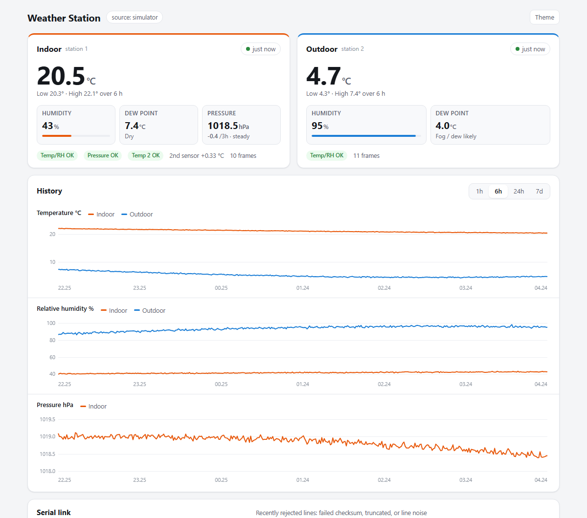
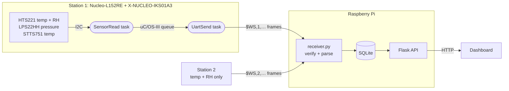
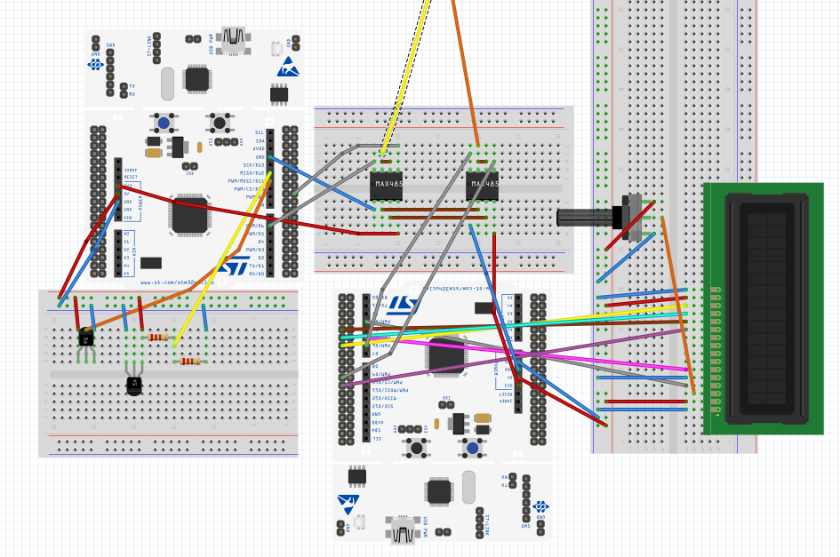
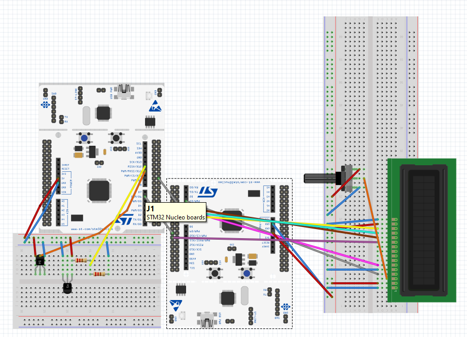
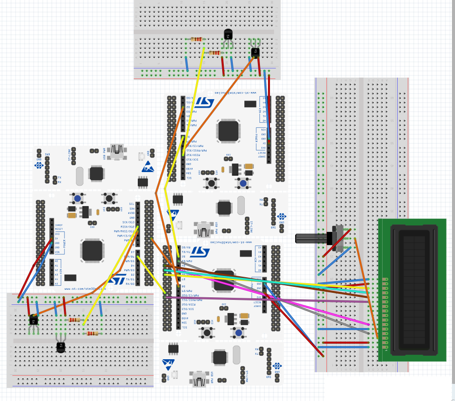
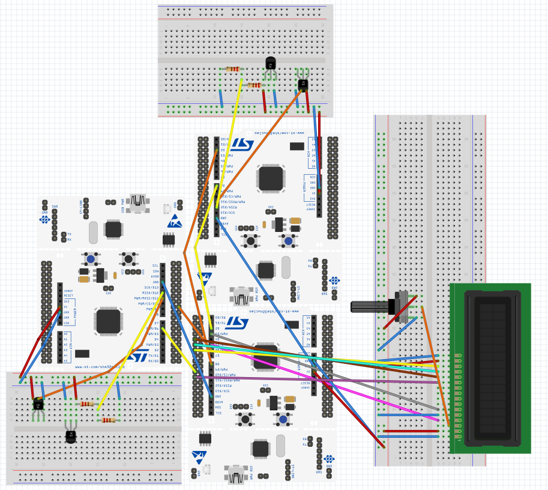

# Weather Station

STM32 weather stations that sample temperature, humidity and pressure under a real-time OS. Each station streams checksummed frames over serial to a Raspberry Pi, which stores the readings and serves a live dashboard for every station.



The project started in 2021 as an embedded systems course project and was revisited in 2026. [Project history](#project-history) explains which parts are original and which were rebuilt.

## How it fits together



| Folder | What it is |
|---|---|
| [`station/`](station/) | Station firmware for the STM32L152RE, built with PlatformIO, STM32Cube HAL and Micrium uC/OS-III |
| [`receiver/`](receiver/) | Python service for the Pi: reads serial, rejects corrupt frames, stores per-station history in SQLite, serves the dashboard |
| [`receiver/static/`](receiver/static/) | Single-file dashboard with no external dependencies, so it works on an offline Pi |
| [`docs/hardware/`](docs/hardware/) | Wiring diagrams of the 2021 build |
| [`legacy/2021-pi/`](legacy/2021-pi/) | The original 2021 Pi script and PHP page, kept for history |

### Station firmware

Three uC/OS-III tasks:

- **AppTaskStart** (prio 1) brings up the clocks, GPIO and UART once, starts the other tasks, and blinks the heartbeat LED: slow when healthy, fast if a sensor has faulted.
- **SensorRead** (prio 3) reads the sensors every 2 s on a drift-free periodic delay and posts each sample to UartSend's task queue.
- **UartSend** (prio 2) blocks on that queue, then formats and transmits a frame.

Every board runs the same firmware. The station number is set at build time with `-DSTATION_ID=n`.

### Wire protocol

One ASCII line per sample:

```
$WS,<station>,<seq>,<temp_cC>,<hum_c%>,<press_Pa>,<temp2_cC>,<status>*<XOR>\r\n

$WS,1,1042,2351,4512,101325,2387,0*23    station 1, all four sensors fitted
$WS,2,17,1234,6550,,,0*2E                station 2, temperature + humidity only
```

- **Values are fixed-point integers:** 2351 means 23.51 °C and 101325 Pa means 1013.25 hPa. The firmware never needs `printf("%f")`, which newlib-nano leaves out by default.
- **Empty fields** mean the station has no such sensor fitted.
- **`seq`** counts samples per station, so the receiver can tell lost frames apart from station restarts.
- **`status`** has a fault bit per sensor slot, so a dead sensor is reported instead of sending stale numbers.
- **The XOR checksum** is the same scheme NMEA GPS uses. Any single-bit error, any truncated line and any line noise is rejected and logged, never stored.

### Receiver and dashboard

`receiver.py` does four things:
- reconnects to the serial port if it drops
- validates every frame, and range-checks values against the sensor datasheets
- keeps 30 days of history per station
- serves a JSON API plus the dashboard

The dashboard shows a card per station with temperature, humidity, dew point and, where fitted, pressure with its 3-hour trend. Below that are history charts with one line per station, and the serial-link health: frames OK, rejected and lost, plus the raw text of recently rejected lines.

## Running it

### Dashboard without any hardware

```sh
cd receiver
python -m venv .venv
.venv\Scripts\activate          # Linux / Pi: source .venv/bin/activate
pip install -r requirements.txt
python receiver.py --simulate --backfill-hours 24 --corrupt-rate 0.03
# open http://localhost:8080/
```

The simulator speaks the firmware's protocol for two stations:
- **Indoor:** the IKS01A3 board, with temperature, humidity, pressure and a second temperature.
- **Outdoor:** temperature and humidity only, with a daily cycle.

`--corrupt-rate` garbles a share of the frames so you can watch them get rejected.

Opening `receiver/static/index.html` directly, or on GitHub Pages, with no API behind it switches the page to an in-browser demo mode.

### On the Raspberry Pi

```sh
python receiver.py --serial /dev/ttyACM0 --names "1=Indoor,2=Outdoor"
```

To start it at boot, see [`weather-receiver.service`](receiver/weather-receiver.service).

### Firmware

```sh
cd station
pio run                      # build
pio run -t upload            # flash over the on-board ST-LINK
pio device monitor -b 115200 # watch the raw frames
```

### Tests

```sh
cd receiver && python -m unittest discover -s tests -v
```

## Project history

### 2021: the original build

The project went through these stages in autumn 2021:

1. **October: single-board prototype.** One NUCLEO-L152RE with the X-NUCLEO-IKS01A3 sensor shield, running uC/OS-III and printing temperature over UART. That firmware is what was in this repo, and it is the basis of today's [`station/`](station/).
2. **November: three-board design.** The design grew to two sensor stations, each a Nucleo with its own temperature and humidity sensors on a breadboard. The meeting notes list a DS18B20 and a HIH-4000 to order. A central Nucleo drove a 16×2 character LCD with a contrast potentiometer. The first diagram linked a station to the central board through MAX485 RS-485 transceivers. Later revisions wire the boards directly.
3. **December: Raspberry Pi.** The central board fed the Pi over USB. A Python 2 script saved readings to CSV and MySQL, and a PHP page showed the last ten as a table. Both are in [`legacy/2021-pi/`](legacy/2021-pi/).

The firmware for the three-board build (station boards, central board and LCD driver) has not survived.

| RS-485 link (first draft) | One station | Two stations | Final |
|---|---|---|---|
|  |  |  |  |

### The garbage-data bugs

The 2021 system was known for nonsense on the display and junk in the Pi's log. The surviving code shows why.

**In the prototype firmware**, four bugs combined:

1. **A float read into an int.** `IKS01A3_ENV_SENSOR_GetValue()` writes a `float`, but the code passed `&data` where `data` was an `int`. The float's raw IEEE-754 bits were then printed with `%d`, so 23.5 °C came out as `1102839808`.
2. **Sending the whole buffer.** `HAL_UART_Transmit(&huart2, MSG, sizeof(MSG), ...)` always sent all 20 bytes of the buffer, not the length of the string. Each line went out padded with NULs and leftovers from earlier messages.
3. **A frozen HAL clock.** The vector table sends SysTick straight to the RTOS, so `HAL_IncTick()` never ran and `HAL_GetTick()` stayed at 0. `HAL_Delay()` could therefore never return, and HAL timeouts could never expire. The fix bases both on the 1 kHz OS tick. `HAL_Delay()` now yields to the scheduler instead of busy-waiting.
4. **Re-initialisation while running.** The UART task re-ran `HAL_Init()`, `SystemClock_Config()` and `MX_USART2_UART_Init()` after the scheduler had started, reprogramming SysTick and the UART under the other tasks. Separately, `MX_I2C1_Init()` was given an uninitialised pointer.

**In the Pi script**, values were read from fixed character positions (`data[4:6]`, `data[11:13]`, …), with nothing checking whether a line was intact. Any shifted or damaged line turned into junk values or a crash. [`legacy/2021-pi/README.md`](legacy/2021-pi/README.md) has the details.

The receiver tests replay both old formats to show they are now rejected. See [`test_original_firmware_output_rejected`](receiver/tests/test_protocol.py) and `test_legacy_2021_pi_format_rejected`.

### 2026: the revisit

- The prototype firmware bugs above are fixed.
- The firmware reads all three IKS01A3 sensors and sends station-tagged, checksummed frames.
- The receiver and dashboard were rewritten for any number of stations.

The firmware builds cleanly with `-Wall -Wextra` (25 KB flash, 8.7 KB RAM) but hasn't been re-run on hardware since 2021. The receiver, protocol and dashboard are covered by unit tests and run against the simulator.

## Hardware

- [NUCLEO-L152RE](https://www.st.com/en/evaluation-tools/nucleo-l152re.html): STM32L152RE, Cortex-M3 at 32 MHz
- [X-NUCLEO-IKS01A3](https://www.st.com/en/ecosystems/x-nucleo-iks01a3.html) sensor shield on I2C1 (PB8/PB9)
- A Raspberry Pi with Python 3.9+
