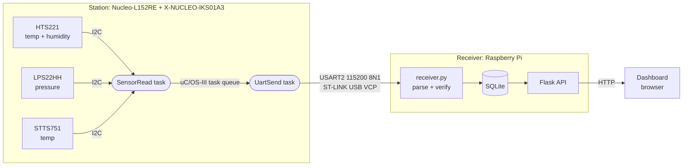

# Weather Station

An STM32 weather station that samples three environmental sensors under a real-time OS, streams checksummed frames over a serial link to a Raspberry Pi, and shows them on a live web dashboard.




## Parts

| Folder | What it is |
|---|---|
| [`station/`](station/) | Firmware for the STM32L152RE, built with PlatformIO, STM32Cube HAL and Micrium uC/OS-III |
| [`receiver/`](receiver/) | Python service for the Pi: reads serial, rejects corrupt frames, stores to SQLite, serves the dashboard |
| [`receiver/static/`](receiver/static/) | Single-file dashboard, no external dependencies, so it works on an offline Pi |

### Station firmware

Three uC/OS-III tasks:

- **AppTaskStart** (prio 1) brings up the clocks, GPIO and UART once, starts the other tasks, and blinks the heartbeat LED: slow when healthy, fast if a sensor has faulted.
- **SensorRead** (prio 3) reads all three sensors every 2 s on a drift-free periodic delay and posts each sample to UartSend's task queue.
- **UartSend** (prio 2) blocks on that queue, then formats and transmits a frame.

### Wire protocol

One ASCII line per sample:

```
$WS,<seq>,<temp_cC>,<hum_c%>,<press_Pa>,<temp2_cC>,<status>*<XOR>\r\n
$WS,1042,2351,4512,101325,2387,0*3E
```

- Values are fixed-point integers: 2351 means 23.51 °C and 101325 Pa means 1013.25 hPa. The firmware never needs `printf("%f")`, which newlib-nano leaves out by default.
- `seq` lets the receiver tell lost frames apart from station restarts.
- `status` has one fault bit per sensor, so a dead sensor is reported instead of sending stale numbers.
- The XOR checksum is the same scheme NMEA GPS uses. Any single-bit error, any truncated line and any line noise gets rejected and logged instead of stored.
- Lines starting with `#` are informational.

### Receiver and dashboard

`receiver.py` does four things:
- reconnects to the serial port if it drops
- validates every line, and range-checks values against the sensor datasheets
- keeps 30 days of history in SQLite
- serves a JSON API plus the dashboard

The dashboard shows:
- current readings, dew point, and the 3-hour pressure trend (barometric tendency)
- both temperature sensors side by side, as a sanity check on each other
- link health: frames OK, rejected and dropped, plus the raw text of recently rejected lines

## The garbage-on-the-display bug

The 2021 version of this project showed nonsense readings, and the PC log was full of junk characters. Going back through the code turned up four separate bugs that combined to cause it:

1. **A float read into an int.** `IKS01A3_ENV_SENSOR_GetValue()` writes a `float`, but the code passed `&data` where `data` was an `int`. The float's raw IEEE-754 bits were then printed with `%d`, so 23.5 °C came out as `1102839808`.
2. **Sending the whole buffer.** `HAL_UART_Transmit(&huart2, MSG, sizeof(MSG), ...)` always sent all 20 bytes of the buffer, not the length of the string. Each line went out padded with NULs and leftovers from earlier messages, which is where the junk in the PC log came from.
3. **A frozen HAL clock.** The vector table sends SysTick straight to the RTOS, so `HAL_IncTick()` never ran and `HAL_GetTick()` stayed at 0. `HAL_Delay()` could therefore never return, and HAL timeouts could never expire. The fix bases `HAL_GetTick()` / `HAL_Delay()` on the 1 kHz OS tick. `HAL_Delay()` now yields to the scheduler instead of busy-waiting.
4. **Re-initialisation while running.** The UART task called `HAL_Init()`, `SystemClock_Config()` and `MX_USART2_UART_Init()` again after the scheduler had started, reprogramming SysTick and the UART under the other tasks. Separately, `MX_I2C1_Init()` was given an uninitialised pointer.

The receiver tests replay the old firmware's exact output to show it is now rejected ([`test_original_firmware_output_rejected`](receiver/tests/test_protocol.py)).

## Running it

### Dashboard without any hardware

```sh
cd receiver
python -m venv .venv && . .venv/bin/activate      # Windows: .venv\Scripts\activate
pip install -r requirements.txt
python receiver.py --simulate --backfill-hours 24 --corrupt-rate 0.03
# open http://localhost:8080/
```

The simulator speaks the same protocol as the firmware: a daily temperature cycle, humidity that tracks it inversely, and pressure that drifts over several days. `--corrupt-rate` garbles a share of the frames so you can watch them get rejected.

Opening `receiver/static/index.html` directly, or on GitHub Pages, with no API behind it switches the page to an in-browser demo mode.

### On the Raspberry Pi

Plug the Nucleo into the Pi over USB, then:

```sh
python receiver.py --serial /dev/ttyACM0
```

To start it at boot, see [`weather-receiver.service`](receiver/weather-receiver.service).

### Firmware

```sh
cd station
pio run                      # build
pio run -t upload            # flash over the on-board ST-LINK
pio device monitor -b 115200 # watch the raw frames
```

### Tests

```sh
cd receiver && python -m unittest discover -s tests -v
```

## Hardware

- [NUCLEO-L152RE](https://www.st.com/en/evaluation-tools/nucleo-l152re.html): STM32L152RE, Cortex-M3 at 32 MHz
- [X-NUCLEO-IKS01A3](https://www.st.com/en/ecosystems/x-nucleo-iks01a3.html) sensor shield on I2C1 (PB8/PB9)
- A Raspberry Pi (any model that runs Python 3.9+)

## Project history

- **2021:** built as an embedded systems project, centred on the STM32 station.
- **2026:** revisited. The firmware bugs above are fixed. The receiver and dashboard were rewritten because the originals were lost.

The current firmware builds cleanly with `-Wall -Wextra` (25 KB flash, 8.7 KB RAM) but hasn't been re-run on hardware since 2021. The receiver, protocol and dashboard are tested against the simulator.
